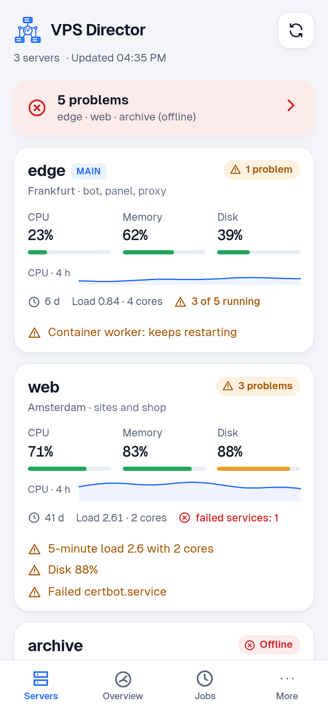
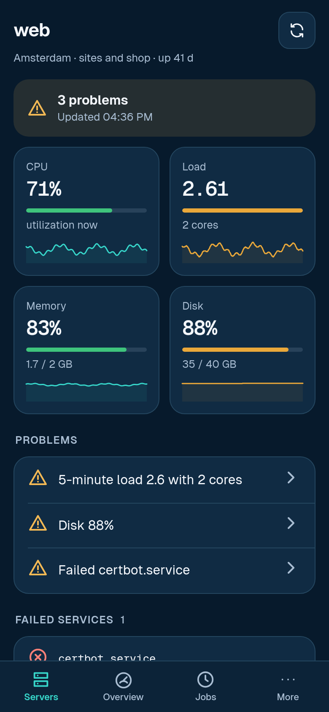
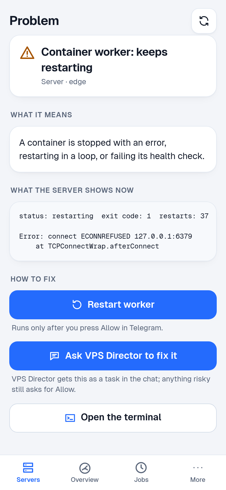
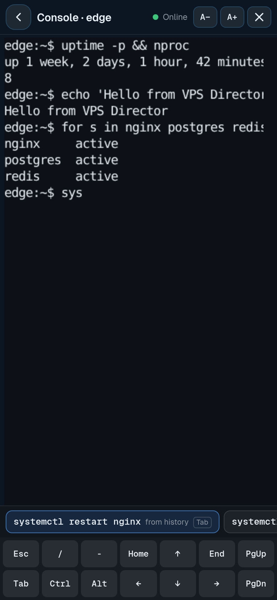
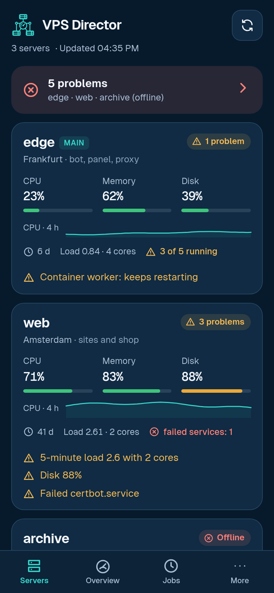
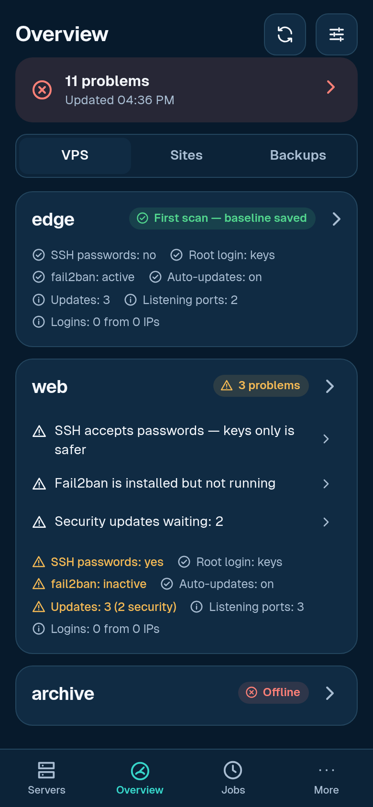
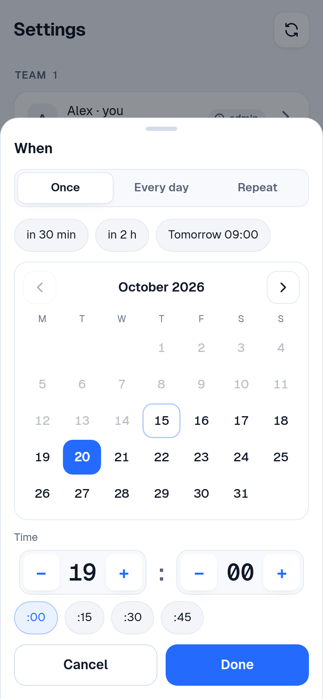

# VPS Director

[](https://github.com/mikhailsemenovykh18-rgb/vps-director/actions/workflows/tests.yml) [](https://github.com/mikhailsemenovykh18-rgb/vps-director/releases) [](LICENSE)

**Your servers, in your pocket.** A Telegram bot and Mini App that run on your VPS: they watch your
servers, sites and backups without any AI, open a real terminal on any of them from your phone, and
hand every task you write to **Claude Code** or **Codex** on the subscription you already pay for.
No API keys, no per-token bills, no Python packages to install.

<p align="center">
  
  
  
  
</p>

[Русская версия ниже](#по-русски) · [Why choose it — and when to pick something else](docs/WHY.md)

## What it does

- **An AI colleague on the server** — write or speak a task; Claude Code / Codex does it right there and answers in the chat.
- **Safe by default** — risky commands come back as *Allow / No* buttons; full access is your explicit choice.
- **Servers without AI** — load, CPU, memory, disk, services and containers of every server, with 24-hour charts.
- **Security** — new SSH logins, new open ports, miners and backdoors, password logins, missing updates.
- **Sites and backups** — status, TLS and domain expiry; backup freshness and test restores.
- **Watchdog and morning brief** — it writes when something breaks and when it recovers.
- **A problem page for every problem** — what it means, live output from the server, one-tap fixes.
- **A terminal in Telegram** — a real shell on any server, survives a lost connection, optional tmux.
- **Tasks and reminders** — once, daily or every N; a calendar picker; scheduled runs stay safe.
- **A team** — admins and read-only members, added by invite link, from contacts or by id.
- **Settings from the phone** — applied at once; light and dark themes; 6 languages.
- **Zero dependencies** — Python standard library, one systemd user service, everything on your server.

## Install

Linux with systemd, Python ≥ 3.10, Claude Code and/or Codex CLI logged in under the same user:

```bash
git clone https://github.com/mikhailsemenovykh18-rgb/vps-director.git && cd vps-director && ./install.sh
```

The installer asks for a bot token from [@BotFather](https://t.me/BotFather), recognises you by the
first message you send to the bot, starts the service and offers to put the Mini App on HTTPS
(a free certificate, no domain needed). Details: [Install in detail](#install-in-detail).

## Why VPS Director

- **It is your server's operator, not just a chat with an AI.** Checks, alerts, charts and fixes
  work without the AI — and without spending your subscription.
- **Your subscription, your server, your data.** It drives the official CLIs that are already logged
  in; nothing goes to a third-party service.
- **You see and approve what happens.** *Allow* grants exactly the command shown, once; a live
  status shows each step; everything lands in an audit log.
- **The phone is enough.** Mini App with charts, problem pages, a terminal that survives the subway,
  a calendar for reminders — in Telegram you already have.
- **Free and open.** MIT licence, no telemetry, no accounts.

## How it compares

Most Telegram bridges for Claude Code / Codex are *remote coding* tools. VPS Director is a
*remote server operator*: the agent is one part, next to AI-free checks that never sleep and a
terminal you can open from the chat.

| | VPS Director | Telegram coding bridges¹ | Claude Remote Control / Channels |
|---|---|---|---|
| Uses your Claude / ChatGPT subscription | ✅ | ✅ | ✅ (Claude only) |
| Zero dependencies, one systemd user service | ✅ | ❌ pip / uv / Go | — |
| Allow exactly this command once, shown in full | ✅ | partly | ✅ in the app |
| Watchdog, `/servers` `/security` `/sites` `/backups` without AI | ✅ | ❌ | ❌ |
| Browser terminal to every server, from Telegram | ✅ | ❌ | ❌ |
| Scheduled tasks, reminders, inbound webhooks, morning brief | ✅ | some | ❌ |
| Resume a terminal session in the chat (`/continue`) | ✅ | some | ✅ |
| Git worktrees, many engines (Gemini, OpenCode…) | ❌ | some | ❌ |
| Interface in 6 languages, light and dark themes | ✅ | ❌ | ❌ |

¹ e.g. claude-code-telegram, Untether, ductor, ccgram — good projects; if you mostly write code from
your phone, one of them may suit you better. More in [docs/WHY.md](docs/WHY.md).

## A colleague, not a tool

The bot has a name (you pick it during setup, or later: *"call yourself Jarvis"*, `/name`), knows
what to call you (*"call me Ann"*), and has a character written into `PROMPT.md`: calm, concise,
a little dry humour, never servile; conclusion first; says when it is not sure; asks before
anything risky. The persona sits between two marker lines at the top of `PROMPT.md`, so renaming
rewrites only that block and leaves your own text alone.

**Memory.** *"remember: backups go to /mnt/backup"* (or *"запомни, что …"*) is appended with the
date to `<instance>/memory.md` and included in the agent's instruction on every task. `/memory`
lists the facts with 🗑 buttons. Things that look like secrets are masked before they are stored:
the instruction is a command-line argument of the CLI (see Security).

**While you were away.** The first message after more than three days of silence starts with a
short digest: server alerts that fired, problems still open, how many scheduled runs happened,
subscription usage.

## Install in detail

Requirements: Linux with systemd, Python ≥ 3.10, and Claude Code and/or Codex CLI installed
and logged in under the same user.

```bash
git clone https://github.com/mikhailsemenovykh18-rgb/vps-director.git
cd vps-director
./install.sh
```

The installer runs the tests, then `director.py setup`: it asks for a bot token (from
[@BotFather](https://t.me/BotFather), hidden input, checked with Telegram) and tells you to send
the bot any message — it shows who wrote and asks *"Is this you?"*. That sender becomes the
owner and the bot's language follows their Telegram language (en, ru, es, de, fr or pt; English
otherwise); no ids to look up. Then it starts a systemd user service `vps-director@main`, checks
that Claude Code is logged in, and offers HTTPS for the Mini App (see below). Open your bot and press
**Start**. To redo the setup later: `python3 director.py setup --force [--instance NAME]`.

**Claude Code login.** The bot runs `claude` as your user, so that user must be logged in. The
sturdiest way is a year-long token: run `claude setup-token`, then put the token into
`~/.config/vps-director/main/engine.env` as `CLAUDE_CODE_OAUTH_TOKEN=…` and restart the service.
If the agent is not logged in, the bot says so after 90 seconds instead of waiting silently.
If the official installer (`curl -fsSL https://claude.ai/install.sh | bash`) hangs on your server,
`npm install -g @anthropic-ai/claude-code` installs the same CLI.

**HTTPS for the Mini App in one command.** Telegram opens Mini Apps only over HTTPS:

```bash
./https.sh                              # https://vpsd-main.<your-ip>.sslip.io — no domain needed
./https.sh --domain bot.example.com     # or your own domain pointing to this server
./https.sh --port 8443                  # when port 443 belongs to something else
sudo ./https.sh --user alice            # as root, for the bot that runs under alice
./https.sh --rollback                   # remove it again
```

It reuses nginx + certbot when nginx already serves other sites here (a separate server block,
checked with `nginx -t` before reload; your sites keep working), otherwise installs Caddy. Port 80
must be reachable for the certificate check; with ufw active it opens 80 and the HTTPS port. Then it
writes `WEB_PORT` and `WEB_URL`, restarts the bot and checks the address.

Describe your server in `~/.config/vps-director/main/PROMPT.md` (projects, services, where logs
are) — the agent reads it on every task.

## Using it

Just write. Short phrases work as commands — `status`, `stop`, `new session`, `limits`
(also in Russian); anything longer is a task for the agent.

| Command | What it does |
|---|---|
| `/status` | server health, no AI, instant |
| `/servers` | every server from `servers.json`: uptime, load, memory, disk, containers, failed services |
| `/security [accept]` | read-only security check of every server against a baseline; `accept` takes the current state as normal |
| `/sites` | every site from `sites.json`: status and time, content check, certificate and domain expiry, hosting dates |
| `/backups [verify [name]]` | is every backup from `backups.json` fresh; `verify` restores a test copy of a restic backup |
| `/new` · `/codex` | new Claude / Codex session |
| `/at <when> <task>` | run a task once: `30m`, `2h`, `1d` or `HH:MM` (server time, next occurrence) |
| `/every <interval> <task>` | repeat: `5m`…`7d`, or `HH:MM` for every day |
| `/remind <when> <text>` | a plain reminder (`/remind every 1d …` repeats) |
| `/jobs` | scheduled jobs with Delete buttons |
| `/brief [HH:MM\|off]` | the morning brief now, or set its time / turn it off |
| `/gh status\|runs\|prs\|issues [owner/repo]` | GitHub at a glance via `gh`; `/gh release vX` publishes a release through the agent |
| `/stop` | stop the current task, clear the queue |
| `/limits` | subscription usage |
| `/sessions` | list and switch sessions |
| `/continue` | pick up a terminal session: the 8 newest Claude Code sessions of `WORKDIR` and Codex sessions started there, as buttons; the chosen one is resumed here (safe mode) |
| `/safe` · `/full` | ask before risky actions / run without asking |
| `/get <path>` | send a file from the server |
| `/audit [N]` | the last N (default 15) entries of the audit log |
| `/director` | create a director bot for a project |
| `/name [new name]` | the bot's name and how it addresses you; with an argument, renames the bot |
| `/memory` | what the bot remembers, with Delete buttons |

Only `/status`, `/new`, `/stop`, `/limits` are shown in the Telegram menu (change with `MENU=`);
the rest work when typed.

### Servers, security, sites, backups (built in, no AI)

Four AI-free skills answer instantly and feed the watchdog and the morning brief. Each one is
off until its file exists in the instance folder (`~/.config/vps-director/<instance>/`); every
check is read-only.

**`servers.json` — the inventory.** The setup offers the hosts of `~/.ssh/config` and you tick
which ones to add; or write it by hand:

```json
[
  {"ssh": "",    "name": "main", "main": true, "where": "Frankfurt", "role": "this bot, the shop"},
  {"ssh": "web", "name": "web",  "where": "Amsterdam", "role": "landing pages",
   "hosting_paid_until": "2026-11-01"}
]
```

`ssh` is an alias from `~/.ssh/config` (`""` = the machine the bot runs on). The bot runs the
system `ssh` with `BatchMode=yes` (keys only, never a password prompt) and an 8-second connect
timeout; the alias must look like a host name. `/servers` probes all servers in parallel (25 s
cap) and shows, per server: role, uptime, 5-minute load against the number of cores, memory,
the `/` disk, containers (`Exited (0)` counts as a normal stop) and failed systemd units
(`fwupd-refresh` is ignored), then a "What to check" list. With `WATCH_INTERVAL` set, the
watchdog probes the other servers too and writes when a problem appears or goes away (a disk
going from 88 % to 89 % is the same problem, not a new alert). `hosting_paid_until` sends a
reminder once a day from 7 days before that date.

**`/security` — what changed on my servers?** Per server, read-only:

- SSH logins of the last 24 h — only time, user and source IP are kept, never the log lines —
  and whether a source IP is new;
- whether SSH accepts passwords, and whether root can log in with one;
- listening TCP ports (`ss -tlnH`), new ones flagged (loopback ports ≥ 32768 come and go and are
  not tracked; a new listener on 127.0.0.1 / ::1 is shown "for information" only — never an
  alert or a brief item). `"ignore_ports": [10904, "10900-10999"]` on a server in
  `servers.json` (see `examples/servers.example.json`) drops those ports from the check entirely (e.g. a job that opens a short-lived
  local port every few minutes);
- Docker containers and images, new ones flagged; images of known miners and "earn money with
  your bandwidth" apps are always flagged;
- processes: kernel-thread names like `[kswapd0]` that are really programs, well-known miners /
  bandwidth sellers / backdoors (xmrig, earnfm, traffmonetizer, gsocket/gs-netcat, …), programs
  running from hiding places (`~/.config/htop/`, dot folders in `/tmp`) or as deleted files from
  temp folders;
- fail2ban running, automatic updates on, pending (security) updates;
- certificates of the sites in `sites.json` that expire within 14 days.

The first check of a server stores its baseline in `security-baseline.json`; later checks
compare against it. When the changes are yours, `/security accept` takes the last check as the
new normal (login IPs are added to the known ones). Logs and SSH settings need root, the `adm`
group or passwordless `sudo` (only `sudo -n` is tried, and only for reading); without them the
check says what it could not read. After the first `/security`, the watchdog runs the check too
and writes about each new finding once.

**`sites.json` — are my sites up?**

```json
[
  {"url": "https://shop.example.com", "name": "shop", "expect": 200, "server": "main"},
  {"url": "https://api.example.com/health", "name": "api", "expect": "ok"}
]
```

`expect` is a status code (default: any 2xx/3xx after redirects) or a text that must be on the
page; `server` is shown when the site is down. `/sites` prints one line per site — status and
response time, days until the TLS certificate expires, days until the domain expires (RDAP via
rdap.org, cached for a day; some country domains have no RDAP and show no date) — then the hosting
dates from `servers.json` and "What to check". The watchdog says a site is down after two failed
checks in a row and "✅ back" when it recovers; a certificate within 14 days, a domain within 30
days and hosting within 7 days get one reminder a day.

**`backups.json` — are my backups fresh?**

```json
[
  {"type": "log", "name": "db dump", "path": "/var/log/db-backup.log",
   "ok": "backup (done|ok)", "fail": "error|failed", "max_age": "26h", "server": "web"},
  {"type": "dir", "name": "dumps", "path": "/srv/dumps", "pattern": "*.sql.gz", "max_age": "2d"},
  {"type": "restic", "name": "offsite", "repository": "sftp:backup-host:/srv/restic",
   "password_file": "/home/me/.restic-pass", "env_file": "/home/me/.restic.env",
   "max_age": "8d", "verify_paths": ["/etc", "/srv/app/config"]}
]
```

- `log`: the last line matching `ok` or `fail` (regular expressions) decides; its time is a
  date written in the line, or the file's modification time. A `fail` line, or a success older
  than `max_age`, is a problem.
- `dir`: the newest file (two levels deep, optional `pattern`) must be younger than `max_age`.
- `restic`: the latest snapshot (`restic snapshots --latest 1 --json --no-lock`), its time and
  size. The repository and the password file go to restic through the environment
  (`RESTIC_REPOSITORY`, `RESTIC_PASSWORD_FILE`), plus the `RESTIC_*` / cloud keys from
  `env_file`; never through the command line, never into the chat.
- `max_age`: `26h`, `8d`, `1d12h`, or a number of days (a weekly backup → `8d`).
- `server`: a name from `servers.json` for `log` and `dir` (default: this machine); `restic`
  runs here. Paths go to the probe on stdin, never into a command line.

`/backups verify [name]` restores the latest snapshot's `verify_paths` into a temporary folder
(`verify_dir`, default the system temp folder — mind the space), reports the number of files and
their size, and removes the folder. `--no-lock` is used everywhere, so the repository is only
read. The watchdog writes when a backup fails or gets too old, and the morning brief has a
backup line.

### Your own commands (scripts)

Drop an executable file into `~/.config/vps-director/<instance>/commands/` and it becomes a
command: `disk.sh` → `/disk`. The name (without extension) must match `[a-z0-9_]{1,32}`; built-in
names win. Optional header in the first 10 lines:

```sh
# desc: Disk usage            <- text in the Telegram menu
# phrases: disk, how much disk  <- whole-message phrases that run it
```

`/disk arg` passes `arg` as the script's first argument (no shell is involved). The script runs
in `WORKDIR` with a 120 s limit; its output (or stderr) is the reply. Nothing goes to the AI.
Scripts are your own files, so they are always allowed for owners, even if `COMMANDS` is
restricted. To list one in the Telegram menu, add its name to `MENU=` (the menu follows that
order). Two examples are in `examples/commands/` (`disk.sh`, `http.sh`). A script named like a built-in
command (`servers`, `security`, `sites`, `backups`, …) is ignored, and the log says so.

### Scheduled tasks

```
/at 18:00 check that tonight's backup finished
/every 1h /disk                 # a script command: no AI, writes only when the output changed
/every 1h --always /disk        # …or every time
/every 09:00 summarize yesterday's nginx errors
/remind 30m call the hosting support
```

Or just say it — phrases are parsed on the server, without AI:

```
remind me in 2 hours to call the bank        напомни через 2 часа позвонить в банк
remind me tomorrow at 10:00 renew the domain напомни завтра в 10:00 продлить домен
remind me on friday at 18:00 …               напомни позвонить маме в 19
every day at 9:00 check the backups          каждый день в 9:00 проверь бэкапы
every 2 hours /disk                          каждые 30 минут /status
```

A phrase whose text starts with a verb like *check / run / restart / проверь / запусти* becomes a
task for the agent; one that starts with `/` runs that script command; anything else is a plain
reminder. The bot confirms with the time it understood and two buttons: **Delete** and
**Change** (send the new time and text, e.g. *"tomorrow at 10:00 call the bank"*). Times of day
use `TZ` from `.env` (setup asks for it; default: the server's zone).

**Morning brief.** If you said yes in setup (or send `/brief 09:00`), every day at that time you
get one message without any AI:

- servers: one line for all of `servers.json` (or this machine's load and disk without it), with
  the problems listed;
- security: what is new since the baseline (login IPs, ports, containers, images, suspicious
  processes) — once you ran `/security`;
- sites from `sites.json` that are down or have a broken certificate;
- backups from `backups.json` (fresh, failed or too old);
- coming up: hosting payments, certificates and domains that expire soon;
- watchdog alerts of the last 24 hours, subscription usage and what is still scheduled today.

The checks run side by side, so the brief takes as long as the slowest server (25 s at most).
`/brief` sends it now, `/brief off` stops it. `BRIEF_CMD` adds the output of your own command at
the end.

Jobs live in `state.json`, survive restarts and run in the normal queue; results start with
`⏰ #<id> <job>`. A missed repeating job (bot stopped) runs once when the bot is back, not once
per missed period. `--changes` makes any job write only when its result changed (default for
script commands and `/status`, the only commands that can be scheduled).

**Unattended runs are always safe.** A scheduled task runs in its own session, in safe mode,
even if you switched that session to `/full`, and without any extra grants. It never offers an
Allow button: anything that needs your approval is reported as *"needs your approval — run it
manually"*, so you can do it yourself or re-run the task from the chat.

### Webhooks (inbound)

Off by default. Set `WEBHOOK_PORT=8787` and `WEBHOOK_SECRET=<long random string>` (the bot refuses
to start with a port and no secret of at least 16 characters). The listener binds to
`127.0.0.1` only.

- `POST /notify` — the text goes to you as a message (`🔔 …`).
- `POST /task` — the text becomes an agent task, only if `WEBHOOK_TASKS=1`. It runs like a
  scheduled task: its own session, safe mode, no Allow buttons; anything that needs your OK is
  reported for you to run by hand. Refused with 429 while 5 tasks are already waiting.

Every request needs the header `X-Director-Secret: <secret>` (or `Authorization: Bearer <secret>`).
The body is JSON with `text` (`message` and `msg` work too) or plain text, up to 64 KB; at most 30
requests a minute. Answers: 200, 400 (empty), 401 (secret), 403 (tasks off), 404, 413, 429.

```bash
# cron / any script on the server
curl -fsS -X POST http://127.0.0.1:8787/notify -H "X-Director-Secret: $SECRET" \
     -d '{"text": "nightly backup finished: 2.1 GB"}'
```

**Uptime Kuma** (on the same server): notification type *Webhook*, URL
`http://127.0.0.1:8787/notify`, body *Preset — application/json* (it sends `msg`), additional
headers `{"X-Director-Secret": "<secret>"}`.

**GitHub Actions** cannot reach `127.0.0.1`: publish the listener through your reverse proxy
(HTTPS, one `location` that proxies to `127.0.0.1:8787`) or a tunnel, keep the secret in the
repository secrets, then:

```yaml
- name: Tell the server
  if: failure()
  run: |
    curl -fsS -X POST https://hooks.example.com/task \
      -H "X-Director-Secret: ${{ secrets.DIRECTOR_SECRET }}" -H "Content-Type: application/json" \
      -d "{\"text\": \"CI failed on ${{ github.ref_name }}: look at run ${{ github.run_id }} and tell me why\"}"
```

### Mini App and dashboard (web)

Off by default. With `WEB_PORT=8090` the bot also runs a small web server on `127.0.0.1:8090`: the
Telegram Mini App, and the same pages as a dashboard in any browser. Plain JavaScript and CSS from
`web/` — no framework, no build step, nothing loaded from a CDN (xterm.js is vendored).

What is in it:

<p align="center">
  
  
  
  
</p>

- **Servers** — a card per server: online or not, load against the number of cores, memory, disk,
  containers running, uptime, a CPU trend for the last 4 hours and the same problems the bot
  reports. The bot samples load / memory / disk every 5 minutes and keeps 24 hours
  (`metrics.json`), so a server's page shows a day of history. Pull down for fresh data.
- **Every problem opens a page** — what it means in plain words, what the server shows right now
  (read-only: the processes eating CPU, `df` and `docker system df`, a container's log, a unit's
  journal, ssh log lines of a new address…) and how to fix it: **ask the agent** (a task in the
  chat), or a fixed action — restart a container or a service, install security updates, start
  fail2ban, mark a new login / port / container as yours — that runs only after **Allow** in
  Telegram. The banner on top, the metric tiles, containers, sites and backups all open such pages.
- **A server** — the numbers in full with 24-hour charts, failed services, problems, its security
  findings, the containers, **Open console**, and *Remove from the list* (with Undo in Telegram).
- **Console** — a terminal with an assistant that suggests as you type (below). It survives a lost
  connection: the app reconnects by itself and shows what you missed.
- **Jobs** — reminders and scheduled jobs: add, tap one to change its text or time, delete.
- **Health** — security, sites and backups; every card opens its own page.
- **Settings** — everything safe to change from a phone, applied right away (written to `.env`,
  the bot restarts itself after the running task): name, how it calls you, language, a time zone
  picked by UTC offset, the morning brief, the working folder, task time limit, how often the
  watchdog looks and when the disk alarm fires, the agent mode (safe or full access), the console
  (on, without Allow, how long it waits for you, inside tmux). The token, ports, URLs, webhooks and
  allowed roots / tools stay hand-edited.
- **Team** — add people as **admin** (everything you can) or **read-only** (alerts and every page,
  but no tasks, no buttons that change anything, no console): with a one-time invite link (24 h),
  by choosing them from your Telegram contacts, or by their id. Change a role or remove someone with
  a tap; the last admin cannot be removed.

It has its own look — a dark control panel with one accent colour and monospace numbers — rather
than Telegram's theme; it follows the phone's safe areas, the native Back and main buttons and
haptic feedback; the language follows `LANG` (six languages), light and dark themes follow the
phone or your choice. Fonts (Geist, OFL) and xterm.js are vendored.

Telegram opens Mini Apps only over HTTPS. `./https.sh` sets it up for you (see
[Install in detail](#install-in-detail)); to do it by hand, put your own HTTPS in front of the port and set
`WEB_URL` to that address (the root of a host, e.g. `https://vps.example.com`). Any of these works;
the console's WebSocket (`/ws/console`) must be passed through too:

```
# Caddy (certificates and WebSockets are automatic)
vps.example.com {
    encode zstd gzip          # the terminal's script is ~290 KB, ~70 KB compressed
    reverse_proxy 127.0.0.1:8090
}
```

```nginx
# nginx (certificates e.g. with certbot)
server {
    listen 443 ssl;
    server_name vps.example.com;
    # ssl_certificate / ssl_certificate_key …
    location / {
        proxy_pass http://127.0.0.1:8090;
        proxy_set_header Host $host;
        proxy_set_header X-Forwarded-For $remote_addr;   # one address, set by you, not appended
        proxy_http_version 1.1;
        proxy_set_header Upgrade $http_upgrade;          # the web console's WebSocket
        proxy_set_header Connection "upgrade";
        proxy_read_timeout 1h;
    }
}
```

```bash
# or a Cloudflare tunnel, without opening ports (quick test: a random trycloudflare.com address;
# for daily use a named tunnel on your own domain)
cloudflared tunnel --url http://127.0.0.1:8090
```

With `WEB_URL` set the chat's menu button becomes **Open** and starts the Mini App.
`/dashboard` sends a one-time login link for a browser (as a button: it works once, for 10
minutes; don't forward it). `/logout_web` signs out of the dashboard everywhere.

| Setting | What | Default |
|---|---|---|
| `WEB_PORT` | port of the web server on 127.0.0.1 (`0` = off) | `0` |
| `WEB_URL` | its public HTTPS address; turns on the menu button and `/dashboard` | — |
| `WEB_BIND` | listen address — anything but loopback is dangerous | `127.0.0.1` |
| `WEB_CONSOLE` | `1` turns on the web console | `0` |

To look around without a server or Telegram: `python3 examples/demo_web.py` starts the real web
server on 127.0.0.1 with made-up servers, sites and backups, prints a one-time link for your browser,
and answers every *Allow* by itself after 3 seconds (`--console` adds a local shell, `--lang ru`).

The JSON API behind the pages is documented in [docs/API.md](docs/API.md) — the same API a phone
app can use.

How it is protected:

- it listens on 127.0.0.1 only; `WEB_BIND` changes that, which is **dangerous** (no HTTPS, the
  log warns) — keep the proxy or tunnel in front instead;
- every API call is authenticated: in the Mini App by Telegram's signed `initData` (checked with
  your bot token, at most 10 minutes old, only `OWNER_IDS`); in a browser by a session cookie
  (HttpOnly, Secure, SameSite=Strict, 12 hours) that only a one-time link gives. Tokens and
  session ids are stored hashed (`<instance>/web-auth.json`, 0600) and never logged;
- changes (adding or deleting a reminder, restarting a container) need a JSON body, the header
  `X-Requested-With: vpsd` and an `Origin` equal to `WEB_URL`;
- failed sign-ins and `/login` are limited to 10 a minute per address;
- **a container restart from the web never happens by itself**: you get *Allow / No* in Telegram,
  and it runs only after *Allow*. A stolen browser session alone cannot change anything on the server;
- logins, launches of the Mini App, restart requests and answers go to the audit log;
- the pages can be framed by Telegram only (`frame-ancestors`); the CSP allows scripts and styles
  from the dashboard itself (plus Telegram's own `telegram-web-app.js`), no inline code, no CDN;
  `Referrer-Policy: no-referrer`. Everything the server sends is put into the page as text, never
  as HTML;
- a Mini App session lives as long as Telegram's `initData` is fresh (10 minutes): after that the
  page asks you to close and reopen it from the bot.

#### Web console (off unless `WEB_CONSOLE=1`)

A terminal to your servers in the Mini App or the dashboard: on the machine the bot runs on, your
login shell in `WORKDIR`; on another server from `servers.json`, `ssh -tt <alias>` (BatchMode, your
own `~/.ssh/config` and keys). It is a full shell with the bot user's rights, so it stays off until
you add `WEB_CONSOLE=1` to `.env`. Even then:

- **every console needs your *Allow* in Telegram** ("Open a console on web-1?"): a stolen browser
  session alone cannot open one. After *Allow* the page gets a one-time ticket (valid 60 s, for your
  user only) that opens the WebSocket `/ws/console`; a second use, a foreign `Origin` or an old
  ticket are refused, and failed tickets count toward the per-address limit;
- the browser chooses a server by its name in `servers.json` and never sends a command line or an
  ssh alias; the process starts with a fixed argv and a short clean environment;
- **a lost connection does not end a console** (like VS Code's remote terminals): when the phone
  drops the network, Telegram is put away or you leave the screen, the shell keeps running and
  its output is kept (the newest 256 KB). The app reconnects by itself and shows what you missed;
  the server page offers *Back to the terminal*. Coming back needs the session's resume token —
  given only over its own WebSocket and rotated on every connect — plus a signed-in API call that
  turns it into a one-time ticket, so no new *Allow*. A console nobody returns to ends after
  `CONSOLE_KEEP` minutes (30); a second window takes it over and the first is told so;
- `CONSOLE_TMUX=1` runs the shell inside `tmux` (or `screen`, or a plain shell when neither is
  installed): what runs there survives even a bot restart or a broken ssh link, and the next
  console attaches to it;
- 30 minutes with no input and no output, or 8 hours in all, end a console; at most 3 are open;
- when a console ends (the × button, a limit, the bot stops) every process started in it gets
  SIGHUP, then SIGKILL after 3 s — outside tmux, programs you want to keep running belong in
  `systemd` or `nohup … &`, started with `setsid`;
- Telegram tells you when a console opens and closes; the audit log records who opened it, on
  which server, for how long and why it ended. What you type and see is never stored.

**The assistant** under the terminal only suggests — it has no AI, no network and never sends a key
by itself. As you type it offers: the fix for a mistyped command (`sytemctl` → `systemctl`,
`dokcer` → `docker`; against a curated list and the programs found in the server's `PATH`) or
subcommand (`systemctl restat` → `restart`); the next word with a one-line explanation
(`systemctl`, `docker`/`docker compose`, `journalctl`, `git`, `apt`, `ufw`, `nginx`, `caddy`, `ss`,
`df`/`du`, `tail`/`grep`, `restic`, `crontab` and ~60 more, from `web/commands.json`); ready
one-liners (`ss -tulpn`, `du -xh -d 1 / | sort -h`, …); and, fish-style, the newest matching line
from this session or your `~/.bash_history` (read-only, last 500 distinct lines; lines that look like
they hold a password or token are left out). **Tab** or **→** takes the highlighted suggestion, a tap
takes any. A red badge warns about destructive commands — `rm -rf` on `/` or your home, `dd` onto a
disk, `mkfs`, `chmod -R 777 /`, a fork bomb, `curl … | sh`, flushing or disabling the firewall,
`reboot`/`shutdown`, deleting Docker volumes, `crontab -r` — it warns, it never blocks. A row of keys
(Esc, Tab, Ctrl, arrows, `|`, `~`, `/`, `-`) helps on a phone keyboard.

### Voice messages

`VOICE_CMD` is any command that prints the transcript of an audio file. A ready one is
`examples/voice/transcribe.py` ([faster-whisper](https://github.com/SYSTRAN/faster-whisper),
runs on the server, no audio leaves it):

```bash
pip install faster-whisper          # or in a venv, then use that venv's python below
# in .env:
VOICE_CMD=python3 /path/to/vps-director/examples/voice/transcribe.py --language en {file}
```

VAD is on (silence is cut, so Whisper does not invent words in it) and the previous segment is
not fed back as a prompt. `--language auto` detects the language, but a fixed one is much more
reliable for messages of a few words. `--model` (default `small`, ≈ 500 MB, downloaded once),
`--device auto|cpu|cuda`, `--compute int8|float16`; the same as `WHISPER_*` environment variables.
If faster-whisper is importable when you run `./install.sh`, the setup offers to fill `VOICE_CMD`
for you. The bot shows what it heard (`🎙 «…»`) before the task goes to the agent.

### GitHub

**Install from a link.** Send a github.com repository link (just the link). The bot fetches the
README from `raw.githubusercontent.com` (public repositories, no token), picks out the install
commands — shell blocks under *Install / Quick start / Getting started / Setup*, plus
`docker compose up`, `pip install`, `npm i -g`, `curl … | sh`, `go install` and the like anywhere —
and shows them with risk notes (*"pipes a script from the internet straight into a shell"*,
*"runs as root"*, *"starts containers that keep running"*, …) and two buttons:

- **Install with the agent** — a new Claude session in safe mode gets exactly these commands,
  to be run one at a time. Every command still comes to you as an exact *Allow* (with the same
  risk notes), so nothing runs without your click. At the end the agent reports what it
  installed, where, and how to remove it.
- **Just show** — the commands as a list to copy; nothing runs.

**`/gh`** (needs the `gh` CLI, logged in): `/gh status`, `/gh runs`, `/gh prs`, `/gh issues` for the
repository in `WORKDIR` or `owner/repo` — no AI, no shell. `/gh release v1.2.0 [owner/repo]` (or
*"publish a release v1.2.0"*, *"выпусти релиз v1.2.0"*) is an agent task: it drafts the notes and
must ask you before anything that leaves the server (push, tag, `gh release create`).

## Configuration

`~/.config/vps-director/<instance>/.env`:

| key | meaning | default |
|---|---|---|
| `BOT_TOKEN` | bot token | required |
| `OWNER_IDS` | Telegram ids allowed to use the bot, comma-separated | required |
| `LANG` | `en` or `ru` | `en` |
| `NAME` | the bot's name (setup asks; *"call yourself …"* changes it) | `VPS Director` |
| `OWNER_NAME` | how the bot addresses you (setup's default: your Telegram first name) | — |
| `TITLE` | older name of `NAME`, used when `NAME` is not set | `VPS Director` |
| `TZ` | your time zone (IANA name, e.g. `Europe/Berlin`) for reminders, `/at HH:MM`, daily jobs and the brief | server time |
| `BRIEF` | morning brief time `HH:MM` (`/brief` changes it) | off |
| `BRIEF_CMD` | a command whose output ends the brief (no shell, 60 s) | — |
| `PROMPT_FILE` | instruction for the agent | `<instance>/PROMPT.md` |
| `WORKDIR` | where the agent runs | `$HOME` |
| `ALLOWED_ROOTS` | `:`-separated absolute folders; `WORKDIR` and `/director` folders must be inside one of them (the bot refuses to start otherwise) and `/get` serves only files inside them (symlinks and `..` resolved) | no limit |
| `COMMANDS` | allowed commands (empty = all) | — |
| `MENU` | commands shown in the Telegram menu | `status,new,stop,limits` |
| `STATUS_CMD` | your own `/status` script | built-in |
| `ALLOWED_TOOLS` | Claude tools allowed without asking, `;`-separated, e.g. `Bash(docker ps:*);Bash(df:*)` | — |
| `WATCH_INTERVAL` | watchdog period in minutes (`0` = off) | `0` |
| `WATCH_DISK_PCT` | disk alarm threshold | `90` |
| `VOICE_CMD` | command that prints a transcript; `{file}` is the audio path (appended if absent). Run without a shell — for pipes, wrap it in a script | voice off |
| `PROGRESS` | live progress message (`0` = off) | `1` |
| `WEBHOOK_PORT` | port of the inbound webhook listener on 127.0.0.1 (`0` = off) | `0` |
| `WEBHOOK_SECRET` | shared secret for webhooks, at least 16 characters | — |
| `WEBHOOK_TASKS` | `1` lets `POST /task` queue agent tasks | `0` |
| `WEB_PORT` | port of the Mini App / dashboard server (`0` = off) | `0` |
| `WEB_URL` | its public HTTPS address (your reverse proxy or tunnel); turns on the menu button and `/dashboard` | — |
| `WEB_BIND` | address the web server listens on — anything but loopback is dangerous | `127.0.0.1` |
| `WEB_CONSOLE` | `1` turns on the web console (a shell in the browser; each one needs *Allow* in Telegram) | `0` |
| `CONSOLE_KEEP` | minutes a console keeps running with nobody connected, waiting for you to come back | `30` |
| `CONSOLE_TMUX` | `1` runs the console inside tmux / screen on the server (survives bot restarts) | `0` |
| `TIMEOUT` | max seconds per task | `3600` |

Values may be quoted; ` # …` after a value is a comment. A number that does not parse falls
back to the default (the log says so).

### A second bot for a project ("director")

From the chat: `/director` → name → what it is responsible for → folder → token of a new
bot from @BotFather. The bot writes `~/.config/vps-director/<name>/`, deletes the token message
and starts `vps-director@<name>`. Or from the shell: `./install.sh --instance shop`.

A narrow, read-only "advisor" director is a common setup:

```
COMMANDS=status
STATUS_CMD=/srv/shop/healthcheck.sh
ALLOWED_TOOLS=Bash(docker ps:*);Bash(docker logs:*);Bash(df:*)
```

## Security — read this

This is a remote control for your server. Treat the bot token like an SSH key.

- The bot refuses to start without `OWNER_IDS` and ignores everyone else, including group chats.
- In the default *safe* mode Claude asks before running anything not explicitly allowed.
  *Allow* grants exactly this action for one turn: the exact command (`Bash(<command>)`), the
  exact file (`Edit(<path>)`), the domain (`WebFetch(domain:<host>)`). The message lists the
  rules it will grant; only for tools without a narrower rule does the button say it allows
  the whole tool. A command or path containing `*` gets no Allow button: in a permission rule
  `*` is a wildcard, so the rule would allow more than you were shown — use `/full` for that
  task or run it yourself. Commands in permission requests are shown literally and in full (no
  Markdown cleanup, no masking, no cutting): what you read is exactly what Allow grants. So a
  request gets **no Allow button** when that cannot be guaranteed — over 1000 characters, line
  breaks or long runs of spaces, invisible or direction-flipping Unicode, or something that looks
  like a password or token (it would have to be masked). Several long requests come as separate
  messages, each Allow under its own full text.
- `/full` (Claude `bypassPermissions`, Codex without sandbox) is your explicit choice per session.
  `AGENT_MODE=full` (Settings → Agent mode, off by default) makes it the default for your own tasks;
  scheduled jobs and webhooks stay safe, and `/safe` pins one session back.
- The agent runs as your user — give that user only the rights you are comfortable with.
- Check the terms of your Claude / ChatGPT plan about automated use of their CLIs.
- Your task text goes to the CLI on stdin, but the instruction from `PROMPT.md` is passed to
  Claude as a command-line argument (`--append-system-prompt`), and other local users can see
  process arguments. Keep secrets out of `PROMPT.md`, and on a shared machine mount `/proc`
  with `hidepid=2` (or use a single-user box).
- **Audit log.** `<instance>/audit.log` (0600, append-only JSON lines) records who did what:
  tasks, commands, Allow / No, mode switches, new directors and scheduled jobs (`from` is your
  Telegram id or `scheduler`), with secrets masked. `/audit [N]` shows the tail. Wizard answers
  (and so bot tokens) are never logged.
- `ALLOWED_ROOTS` fences what the *bot* touches (`WORKDIR`, director folders, `/get`). It is not
  a sandbox for the agent: in `/full` mode Claude or Codex can still go anywhere your user can.
- Progress lines and logs mask obvious secrets (`-p…`, `password=…`, `token=…`, `Bearer …`);
  `state.json`, `director.log` and downloads are readable by your user only.
- **Engine login.** On a server, log the engines in with a long-lived token instead of the
  interactive login: `claude setup-token`, then put `CLAUDE_CODE_OAUTH_TOKEN=…` into
  `<instance>/engine.env` (chmod 600, or it is ignored). Only `claude`/`codex` get it — not your
  script commands, not the web console, not the bot's own process environment — and it is read on
  every run, so a new token needs no restart. It also stops the bot from refreshing (and so
  logging out) the interactive login you use in your own terminal.
- **Outbox.** Files the agent copies into `<instance>/outbox/` are sent to you after its answer
  and deleted. Only regular files: a symlink there is never followed (it is removed), so an agent
  cannot point one at a key; over 50 MB is moved to `outbox-kept/`.
- **Mini App sessions.** The Mini App swaps Telegram's signed `initData` (fresh 10 minutes) once
  for a session token: random, bound to your id, stored hashed, one hour after the last call and
  12 hours at most; `/logout_web` revokes it.

### Known limitations

- **Codex has no Allow path.** In safe mode Codex runs in a read-only sandbox; when it needs to
  change something, the only switch is `/full` for that session.
- Telegram limits: bots download files up to 20 MB and upload up to 50 MB. A failed download
  is reported, the rest of the message still goes to the agent.
- Answers longer than ~12 000 characters arrive as a `.txt` file with the beginning in the chat.
- Slow work (voice, downloads, script commands, `/status`, `/get`) runs in the background, so a
  file and a text sent right after it may reach the agent in the other order.

## Development

```bash
python3 -m unittest discover -s tests
node --test web/tests/*.test.js       # the console assistant (also run by the Python suite when node exists)
python3 examples/demo_web.py          # the web pages with made-up data on 127.0.0.1
```

MIT License. `web/vendor/xterm/` is xterm.js (MIT, see its LICENSE.txt); `web/vendor/fonts/` is Geist and Geist Mono (SIL OFL 1.1, see its LICENSE.txt).

---

## По-русски

**Ваши серверы у вас в кармане.** Telegram-бот и Mini App, которые живут на вашем VPS: без ИИ следят
за серверами, сайтами и бэкапами, открывают настоящий терминал на любом сервере прямо с телефона
и передают каждую задачу в **Claude Code** или **Codex** — по подписке, которая у вас уже есть.
Без API-ключей, без счетов за токены, без лишних пакетов.

Коротко:
- **ИИ-коллега на сервере** — пишете или наговариваете задачу, агент делает её прямо там;
- **безопасно по умолчанию** — рискованное приходит кнопками «Разрешить / Нет», полный доступ — только по вашему выбору;
- **серверы без ИИ** — нагрузка, CPU, память, диск, службы и контейнеры, графики за сутки;
- **безопасность, сайты, бэкапы** — новые входы и порты, майнеры, сертификаты и домены, свежесть копий;
- **сторож и утренняя сводка** — пишет, когда что-то сломалось и когда починилось;
- **страница у каждой проблемы** — что это значит, живой вывод с сервера, исправление в одно касание;
- **терминал в Telegram** — переживает обрыв связи, по желанию внутри tmux;
- **задачи и напоминания** с календарём; **команда** с ролями «администратор» и «только чтение»;
- **настройки с телефона**, светлая и тёмная темы, 6 языков; **ноль зависимостей**.

Установка одной командой:

```bash
git clone https://github.com/mikhailsemenovykh18-rgb/vps-director.git && cd vps-director && ./install.sh
```

Установщик сам предложит включить HTTPS для Mini App (бесплатный сертификат, домен не нужен);
позже это делает `./https.sh`. Агенту нужен вход в Claude Code под тем же пользователем: надёжнее
всего `claude setup-token` и токен в `~/.config/vps-director/main/engine.env`
(`CLAUDE_CODE_OAUTH_TOKEN=…`). Если вход не выполнен, бот скажет об этом через 90 секунд.

Подробнее:

Что умеет:
- у бота есть имя и характер: имя и обращение к вам спрашивает установка, потом — «зови себя …»,
  «зови меня …» или `/name`; спокойный, по делу, с лёгкой иронией, сначала вывод, перед
  рискованным спрашивает. Характер записан блоком в начало `PROMPT.md`;
- память: «запомни: бэкапы лежат в /mnt/backup» — факт с датой ложится в `memory.md` и уходит
  агенту с каждой задачей; `/memory` показывает и удаляет. Похожее на пароли скрывается;
- после трёх дней тишины первое сообщение начинается со сводки «пока тебя не было»: тревоги,
  что не решено, сколько было запусков по расписанию, расход подписки;
- выполняет задачи текстом и голосом, присылает и принимает файлы;
- задачи по расписанию: `/at 18:00 …`, `/every 1h /disk` (скрипт, пишет только при изменениях),
  `/remind 30m …`, список `/jobs`; по расписанию — всегда безопасный режим, без кнопок
  «Разрешить»: что требует разрешения, приходит как «выполни вручную»;
- напоминания и задачи фразами, без ИИ: «напомни через 2 часа позвонить в банк», «напомни завтра
  в 10:00 …», «каждый день в 9:00 проверь бэкапы», «каждые 2 часа /disk». Если текст начинается
  с глагола вроде «проверь/запусти» — это задача агенту, с «/» — команда-скрипт, иначе
  напоминание. В ответ — понятое время и кнопки «Удалить» / «Изменить». Время — по `TZ`;
- утренняя сводка (`BRIEF=09:00` или `/brief 09:00`): серверы, новое по безопасности, упавшие
  сайты, свежесть бэкапов, что скоро истекает (хостинг, сертификаты, домены), тревоги за сутки,
  расход подписки, что запланировано на сегодня — одним сообщением, без ИИ;
- вебхуки (выключены по умолчанию): `WEBHOOK_PORT` + `WEBHOOK_SECRET`, слушает только 127.0.0.1;
  `POST /notify` — сообщение вам, `POST /task` (с `WEBHOOK_TASKS=1`) — задача агенту по правилам
  расписания (своя сессия, безопасный режим, без кнопок). Примеры для cron, Uptime Kuma и
  GitHub Actions — в английской части;
- Mini App и панель в браузере (выключены по умолчанию): `WEB_PORT` + `WEB_URL` (HTTPS через
  ваш прокси или туннель), слушает только 127.0.0.1; `/dashboard` — одноразовая ссылка для входа,
  `/logout_web` — выйти везде; перезапуск контейнера из панели — только после «Разрешить» в Telegram;
  экраны: серверы (нагрузка, память, диск, контейнеры, проблемы ✅/⚠️/❌, потянуть вниз — обновить),
  страница сервера, задачи и напоминания, безопасность / сайты / бэкапы, настройки; тема и кнопки
  Telegram, тактильный отклик, русский или английский по `LANG`; посмотреть без серверов —
  `python3 examples/demo_web.py`; API описан в `docs/API.md`;
- консоль в браузере (`WEB_CONSOLE=1`, иначе выключена): ваша оболочка на этом сервере или
  `ssh -tt` к серверу из `servers.json`; каждая консоль — только после «Разрешить» в Telegram,
  одноразовый билет на 60 с, не больше 3 консолей; обрыв связи консоль не закрывает (ждёт `CONSOLE_KEEP` минут), 30 минут без ввода и вывода или 8 часов — закрывается,
  все процессы консоли завершаются; об открытии и закрытии бот пишет в Telegram, ввод не хранится;
  под терминалом — подсказчик без ИИ и сети: исправит опечатку (`sytemctl` → `systemctl`), подскажет
  следующее слово с пояснением, готовые однострочники и строку из истории (Tab или → — принять),
  а на опасные команды (`rm -rf /`, `mkfs`, `curl … | sh`, `ufw disable`, `reboot` …) покажет красное
  предупреждение — только предупреждение, ничего не запрещает; клавиши как в Termux — два ряда
  (Esc, /, -, Home, ↑, End, PgUp · Tab, Ctrl, Alt, ←, ↓, →, PgDn), размер шрифта — A−/A+ или щипком;
- вход движков на сервере — долгим токеном: `claude setup-token`, затем
  `CLAUDE_CODE_OAUTH_TOKEN=…` в `<экземпляр>/engine.env` (chmod 600). Его получают только
  claude/codex — не скрипты, не консоль; обычный вход в вашем терминале бот больше не трогает;
- файлы от агента: всё, что он положит в `<экземпляр>/outbox/`, бот пришлёт после ответа и удалит
  (только обычные файлы, по ссылкам не ходит, до 50 МБ); `/limits` показывает и расход Codex;
- GitHub: пришлите ссылку на репозиторий — бот прочитает README, покажет команды установки с
  пометками о риске («скачивает скрипт и сразу отдаёт shell», «от root») и кнопки «Установить
  через агента» (безопасный режим, каждая команда — через «Разрешить», в конце отчёт: что, куда,
  как удалить) и «Просто показать». `/gh status|runs|prs|issues` — через утилиту `gh`, без ИИ;
  «выпусти релиз v1.2.0» — задача агенту, перед push он спросит;
- голосовые: готовый `examples/voice/transcribe.py` на faster-whisper (всё на сервере, VAD
  включён); если faster-whisper установлен, установщик сам предложит прописать `VOICE_CMD`.
  Для коротких сообщений лучше задать язык: `--language ru`;
- `/continue` — продолжить в Telegram сессию Claude Code или Codex, начатую в терминале;
- журнал действий `audit.log` (кто, что, когда; секреты скрыты) и `/audit [N]`; `ALLOWED_ROOTS`
  ограничивает папки бота (`WORKDIR`, папки директоров, `/get`), но не песочница для агента;
- показывает ход работы в реальном времени, а не молчит две минуты;
- `/status` мгновенно, без ИИ; сторож пишет, только если на сервере что-то сломалось;
- `/servers` — все серверы из `servers.json` (установщик предлагает хосты из `~/.ssh/config`):
  нагрузка против числа ядер, память, диск, контейнеры, упавшие сервисы и «Что проверить»;
  по ssh только с ключами (`BatchMode`), только чтение. `hosting_paid_until` — напоминание об
  оплате хостинга за 7 дней;
- `/security` — проверка безопасности всех серверов, только чтение: входы по SSH за сутки (время,
  пользователь, IP — без строк журнала), новые IP, пароли и root в SSH, новые порты, контейнеры и
  образы, маскировка под потоки ядра, известные майнеры/«заработок на трафике»/бэкдоры (xmrig,
  earnfm, traffmonetizer, gsocket), fail2ban, автообновления, сертификаты сайтов. Первая проверка
  запоминает норму, `/security accept` принимает изменения; сторож пишет о каждом новом пункте;
- `/sites` — сайты из `sites.json`: код ответа и время, текст на странице, сколько дней до конца
  сертификата и домена (RDAP, раз в сутки), даты оплаты хостинга. Сторож пишет «не работает» после
  двух неудачных проверок подряд и «снова работает», когда починилось; сертификат < 14 дней, домен
  < 30 дней, хостинг < 7 дней — напоминание раз в день;
- `/backups` — бэкапы из `backups.json`: `log` (последняя строка успеха/ошибки в журнале), `dir`
  (самый свежий файл в папке), `restic` (последний снимок, время и размер; репозиторий и пароль —
  только через переменные окружения). `max_age` — сколько копии можно быть старой (`26h`, `8d`).
  `/backups verify [имя]` — пробное восстановление `verify_paths` во временную папку: число файлов
  и размер, папка удаляется, репозиторий только читается (`--no-lock`). Сторож пишет, если бэкап
  упал или устарел;
- `/limits` — сколько подписки Claude израсходовано, предупреждает на 80 % и 90 %;
- «директора» — отдельный бот на каждый проект со своей инструкцией (`/director`);
- безопасность по умолчанию: только ваш Telegram id, опасные действия — кнопками;
  «Разрешить» разрешает ровно это действие (эту команду, этот файл) на один ход; у команды
  со «*» кнопки нет — в правиле это шаблон, разрешение вышло бы шире (только `/full` или руками).

Свои команды: положите исполняемый файл в `~/.config/vps-director/main/commands/` — `disk.sh`
станет `/disk`. В шапке: `# desc: …` (подпись в меню) и `# phrases: a, b` (фразы, которые его
запускают). Запуск без shell, лимит 120 с, вывод скрипта уходит в чат, ИИ не участвует.
Чтобы команда попала в меню, добавьте её имя в `MENU=`. Примеры — в `examples/commands/`.

Ограничения: файлы из Telegram бот скачивает до 20 МБ (отправляет до 50 МБ); у Codex в
безопасном режиме нет кнопки «Разрешить» — только `/full`. Инструкция из `PROMPT.md` передаётся
Claude аргументом командной строки — не храните в ней секретов, а на общей машине смонтируйте
`/proc` с `hidepid=2`.

Установка: `git clone …`, затем `./install.sh` — скрипт спросит токен бота и попросит написать
боту любое сообщение: отправитель после подтверждения «Is this you?» становится владельцем,
язык берётся из его Telegram. Искать свой id не нужно.
Опишите свой сервер в `~/.config/vps-director/main/PROMPT.md`. Для русских сообщений бота
поставьте `LANG=ru` в `.env`.
